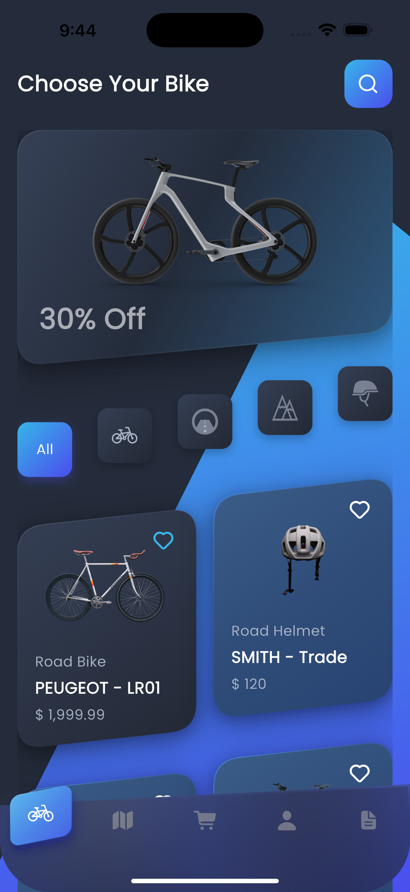
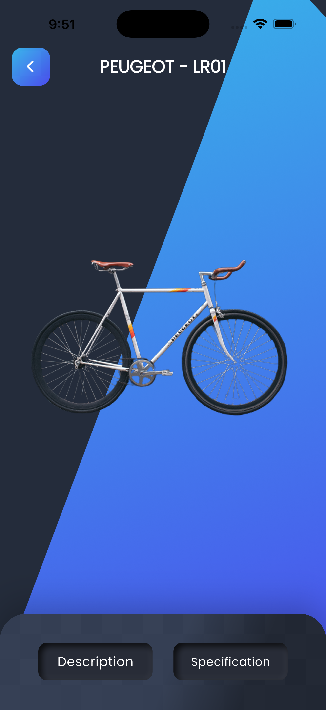
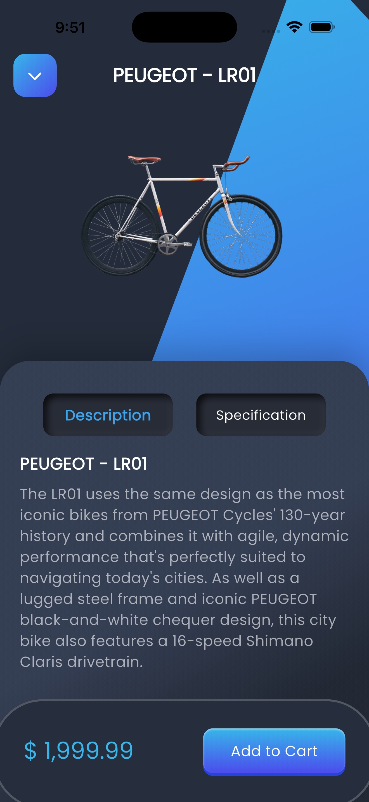
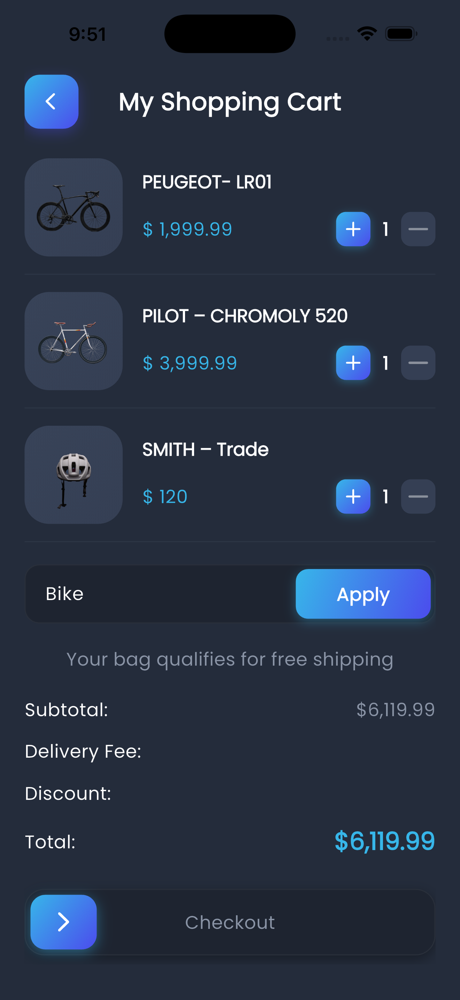
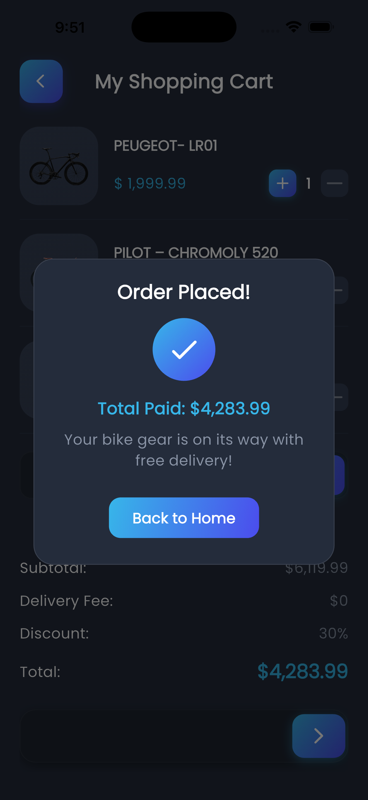

# 🚲 Bike Store — Futuristic Cycling & Gear E-Commerce Mobile App

<p align="center">
  
  
  
  
  
</p>

<p align="center">
  <b>Bike Store</b> is a premier, high-performance Flutter mobile application built for cycling enthusiasts and athletes. Designed with a sleek, dark neumorphic aesthetic, glowing electric gradients, fluid animations, and gesture-driven interactions, it delivers a best-in-class digital shopping experience from product discovery to slide-to-checkout.
</p>

---

## 📱 App Preview & Screenshots

Explore the user experience and key interfaces of the Bike Store application:

### 🌟 Catalog Discovery & Product Experience

| 01. Catalog & Home | 02. Product Showcase | 03. Specifications Sheet |
| :---: | :---: | :---: |
|  |  |  |
| **Catalog & Navigation**<br>Promotional banners, category filters, product cards & curved navbar | **Split-Screen Canvas**<br>Diagonal split background staging with smooth Hero transitions | **Interactive Bottom Sheet**<br>Detailed bike specifications, storytelling, & quick Add-to-Cart |

<br>

### 🛒 Checkout Flow & Order Fulfillment

| 04. Shopping Cart & Discount | 05. Order Placed Confirmation |
| :---: | :---: |
|  |  |
| **Interactive Shopping Cart**<br>Item quantity steppers, promo coupon (`Bike`), and interactive Slide-to-Checkout | **Order Placed Dialog**<br>Real-time order summary, total paid breakdown, and seamless return to catalog |

---

## ✨ Key Features

- 🎨 **Futuristic Neumorphic & Cyber-Dark UI**:
  - Deep slate navy surfaces (`#242C3B`, `#353F54`, `#222834`).
  - Signature gradient highlights (`#37B6E9` Sky Cyan $\rightarrow$ `#4B4CED` Royal Indigo).
  - Subtle inset shadows powered by `flutter_inset_shadow` for tactile depth.
  - Modern typography powered by Google Fonts (`Poppins`).

- ⚡ **Dynamic Category Filtering**:
  - Filter across **All**, **Bicycles**, **Road**, **Mountain**, and **Helmets**.
  - Vibrant active indicators with glowing gradient borders and custom SVG icons.

- 🚴 **Immersive Product Details**:
  - Diagonal geometric split-canvas background for dynamic bike presentation.
  - Interactive sliding bottom sheet toggling seamlessly between **Description** and **Specification** tabs.
  - Floating bottom bar featuring clear pricing and high-contrast "Add to Cart" gradient action.

- 🛍️ **Smart Cart & Financial Calculator**:
  - Responsive quantity increment/decrement controls per item with automatic price recalculation.
  - Promotional coupon engine (applying coupon `Bike` grants an instant **30% discount**).
  - Dynamic free delivery qualifier badge.
  - Live breakdown of **Subtotal**, **Delivery Fee**, **Discount**, and **Total Amount**.

- 🚀 **Interactive Slide-to-Checkout**:
  - Custom gesture-driven slider with smooth spring physics and drag tracking.
  - Prevents accidental purchases while providing satisfying tactile interaction.

- 💎 **Custom Polygon Curved Navigation Bar**:
  - Bespoke clipped geometric navigation bar with elevated active indicator and vector icons.

- 📐 **Pixel-Perfect Responsive Layout**:
  - Scaled using `flutter_screenutil` based on an iPhone design baseline (`375 × 812`), guaranteeing consistent proportions on all screen sizes and densities.

---

## 🏗️ Architecture & Code Organization

The application is structured following **Clean Architecture** and **SOLID design principles**, ensuring separation of concerns, testability, and high maintainability:

```text
lib/
├── core/
│   ├── route/
│   │   └── on_generate_route.dart        # Centralized named route generator
│   └── utils/
│       ├── app_colors.dart               # Palette tokens & brand gradients
│       ├── app_text_styles.dart          # Scaled Poppins typography system
│       ├── app_theme.dart                # Global ThemeData configuration
│       └── assets.dart                   # Strongly-typed asset constants
├── shared/
│   └── widgets/
│       ├── bike_container_presenter.dart # Custom diagonal split canvas presenter
│       ├── custom_bottom_nav_bar.dart    # Custom curved polygon navigation bar
│       ├── custom_icon_container.dart    # Reusable square icon wrapper
│       └── custom_inner_shadow_container.dart # Neumorphic inset-shadow widget
├── views/
│   ├── home_view.dart                    # Main catalog screen
│   ├── product_details_view.dart         # Split-canvas product overview screen
│   ├── my_shopping_cart_view.dart        # Shopping cart & checkout screen
│   └── widgets/
│       ├── bike_promotion_card.dart      # Discount hero banner (30% Off)
│       ├── cart_coupon_field.dart        # Promo input & apply button
│       ├── cart_item_card.dart           # Single cart item with stepper
│       ├── cart_item_model.dart          # Immutable cart data model
│       ├── cart_order_summary.dart       # Subtotal, discount & total card
│       ├── cart_quantity_selector.dart   # Minus/Plus quantity selector
│       ├── product_card_widget.dart      # Catalog grid product item
│       ├── product_categories.dart       # Category selection pills
│       ├── product_details_custom_bottom_sheet.dart # Expandable specs drawer
│       ├── slide_to_checkout_button.dart # Custom gesture slider button
│       └── ...
└── main.dart                             # Application entry point & ScreenUtil init
```

---

## 🎨 Design System & Color Tokens

| Token | Hex | Preview | Role |
| :--- | :--- | :---: | :--- |
| **Background / Dark Blue** | `#242C3B` | `■` | Primary app scaffold background |
| **Light Blue / Cyan** | `#37B6E9` | `■` | Gradient start, accents, and glow states |
| **Royal Blue / Primary** | `#4B4CED` | `■` | Brand primary color, buttons, and gradient end |
| **Card Color / Slate Blue** | `#353F54` | `■` | Neumorphic card & container surfaces |
| **Deep Navy / Dark Surface**| `#222834` | `■` | Bottom navigation bar & input backgrounds |

---

## 🛠️ Tech Stack & Dependencies

| Package | Version | Purpose |
| :--- | :---: | :--- |
| **[Flutter](https://flutter.dev/)** | `SDK >=3.11.5` | Modern cross-platform framework |
| **[flutter_screenutil](https://pub.dev/packages/flutter_screenutil)** | `^5.9.3` | Responsive UI adaptation across varying screen densities |
| **[google_fonts](https://pub.dev/packages/google_fonts)** | `^8.2.1` | Clean typography (`Poppins`) |
| **[svg_flutter](https://pub.dev/packages/svg_flutter)** | `^0.0.1` | Crisp vector graphic rendering |
| **[flutter_inset_shadow](https://pub.dev/packages/flutter_inset_shadow)** | `^2.0.3` | Custom inner-shadows for tactile neumorphic depth |
| **[gap](https://pub.dev/packages/gap)** | `^3.0.1` | Predictable spacing widgets |
| **[cupertino_icons](https://pub.dev/packages/cupertino_icons)** | `^1.0.8` | iOS style iconography |

---

## 🚀 Getting Started

Follow these steps to run the project locally on your machine:

### Prerequisites

- [Flutter SDK](https://docs.flutter.dev/get-started/install) (`^3.11.5` or later)
- [Dart SDK](https://dart.dev/get-dart)
- Xcode (for iOS Simulator / physical device) or Android Studio (for Android Emulator / device)

### Installation

1. **Clone the repository**:
   ```bash
   git clone https://github.com/Nidhal-Khazene/bike_store.git
   cd bike_store
   ```

2. **Install Flutter packages**:
   ```bash
   flutter pub get
   ```

3. **Verify Flutter setup**:
   ```bash
   flutter doctor
   ```

4. **Run the application**:
   ```bash
   # Launch on your connected emulator or device
   flutter run
   ```

---

## 💡 How to Test the Checkout & Coupon Flow

1. **Browse & Explore**: On the Home screen, filter categories or select any bike (e.g. `PEUGEOT - LR01`).
2. **Inspect Specs**: In the product view, drag or inspect the **Description** and **Specification** tabs on the bottom sheet, then tap **Add to Cart**.
3. **Open Cart**: Navigate to the shopping cart via the navigation bar or top cart icon.
4. **Test Coupon**: The coupon field comes pre-filled with the code **`Bike`**. Tap **Apply** to instantly deduct **30%** from the subtotal.
5. **Slide to Checkout**: Drag the cyan arrow button smoothly across the track. Upon reaching the end, an **Order Placed!** confirmation dialog will celebrate your purchase with free shipping.

---

## 👤 Author

**Nidhal Khazene**
- GitHub: [@Nidhal-Khazene](https://github.com/Nidhal-Khazene)
- Project Repository: [bike_store](https://github.com/Nidhal-Khazene/bike_store)

---

## 📄 License

This project is licensed under the [MIT License](LICENSE). Feel free to use this codebase as inspiration for your own Flutter UI/UX endeavors!

<p align="center">
  ⭐ If you enjoyed this project, please consider giving it a star on GitHub! ⭐
</p>
